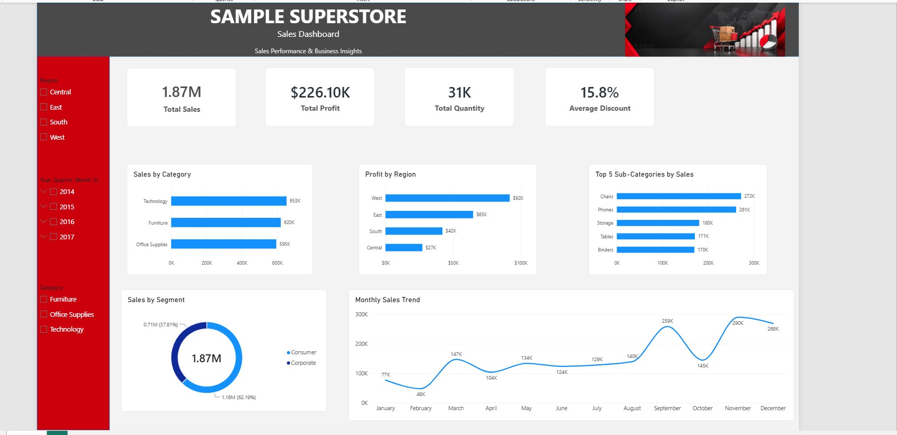

# 🛒 Superstore Sales Analysis | Power BI Dashboard

## 📊 Project Overview

This project presents an interactive **Superstore Sales Dashboard** built using Microsoft Power BI. It provides insights into sales performance, profitability, product categories, regional performance, customer segments, and monthly sales trends.

## 🖼️ Dashboard Preview

## 🎯 Project Objectives

- Analyze overall sales and profit performance.
- Compare sales across product categories.
- Identify regional profit performance.
- Highlight the top 5 sub-categories by sales.
- Understand sales distribution across customer segments.
- Track monthly sales trends.

## 📌 Key Performance Indicators (KPIs)

- **Total Sales:** 1.87M
- **Total Profit:** $226.10K
- **Total Quantity:** 31K
- **Average Discount:** 15.8%

*Note: KPI values are based on the dashboard screenshot and should be verified against the final Power BI report.*

## 📈 Dashboard Features

- Interactive Region slicer
- Order Date and Year filters
- Product Category slicer
- Sales by Category
- Profit by Region
- Top 5 Sub-Categories by Sales
- Sales by Segment
- Monthly Sales Trend

## 💡 Key Business Insights

- Technology has the highest sales among the three displayed product categories.
- The West region shows the highest profit among the four regions.
- Chairs and Phones lead the displayed top 5 sub-categories by sales.
- Consumer is the largest customer segment in the displayed dashboard.
- Monthly sales fluctuate, with higher values visible in September and November.

## 🛠️ Tools & Technologies

- Microsoft Power BI
- Data Visualization
- Interactive Dashboards
- Superstore CSV Dataset

## 📂 Project Files

- `Sample_Superstore_Sales_Dashboard.pbix` — Power BI dashboard file
- `Sample - Superstore.csv` — Source dataset
- `Images/Pr_1_Dashboard.jpg` — Dashboard preview image

## 👨‍💻 Author

**Yash Pandey**

---

⭐ If you find this project useful, feel free to explore the repository and share your feedback.

---

## 🎬 Project Demo Video

Watch my Power BI dashboard demonstration:

▶️ [Watch Superstore Sales Analysis Demo](https://youtu.be/N6gZ_PW4E3I)
